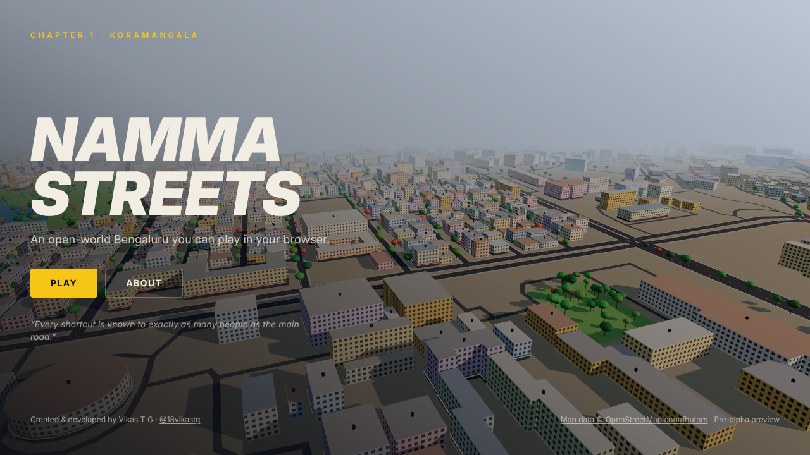
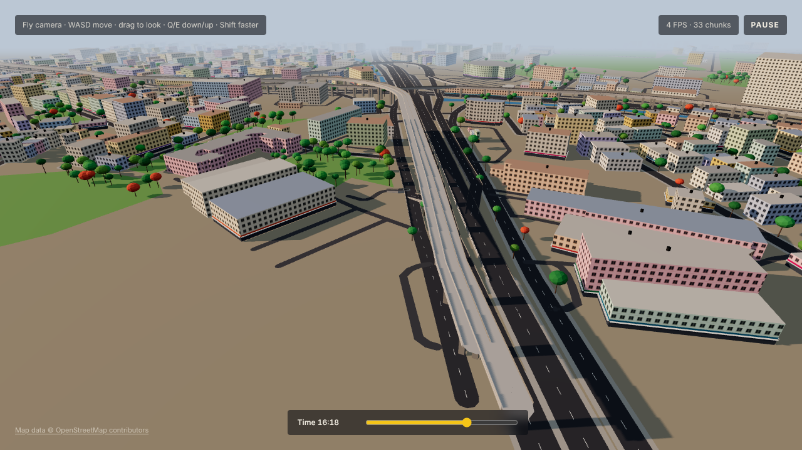
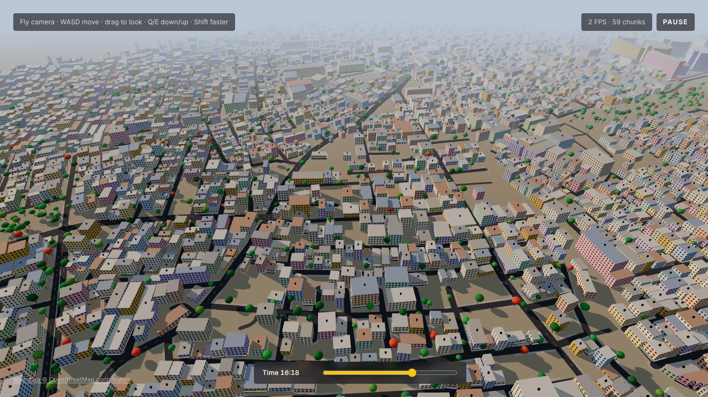

# Rowdy Journey (working title)

**Created & developed by Vikas T G** — Software Development Engineer, Bengaluru ·
[@18vikastg](https://github.com/18vikastg)

An original, open-world, browser-based 3D game set in a stylised Bengaluru.
Roam Koramangala, borrow an auto, dodge the traffic and the Hoysala Heat.

> `gta-bengaluru` is an internal codename only. The public title is not final;
> see [docs/ROADMAP.md](docs/ROADMAP.md).



| Silk Board                                              | Streets                                  | Night                                |
| ------------------------------------------------------- | ---------------------------------------- | ------------------------------------ |
|  |  |  |

## Status

Pre-alpha. M0 (scaffold, CI) and M1 (the real Koramangala, Silk Board and HSR
street map, streamed) are in; M2 (on-foot player and the auto-rickshaw) is next. See the [roadmap](docs/ROADMAP.md).

## Quick start

```sh
corepack enable
pnpm install
pnpm dev
```

| Command                                    | What it does                                 |
| ------------------------------------------ | -------------------------------------------- |
| `pnpm dev` / `pnpm dev:site`               | Run the game / landing site locally          |
| `pnpm build`                               | Build everything                             |
| `pnpm lint`, `pnpm typecheck`, `pnpm test` | Static checks and unit tests                 |
| `pnpm e2e`                                 | Playwright smoke test against the built game |

## Layout

```
apps/game         Vite + React Three Fiber game
apps/site         Astro landing page
packages/engine   Game logic (fixed-step loop, RNG, sun model, ...)
packages/content  Branding, tips, and later missions and dialogue
tools/            Offline map and asset pipelines
docs/             Architecture, roadmap, contributing
```

More: [ARCHITECTURE](docs/ARCHITECTURE.md) · [CONTRIBUTING](docs/CONTRIBUTING.md) · [CREDITS](CREDITS.md)

## Credits

Created & developed by **Vikas T G**. Map data © OpenStreetMap contributors (ODbL). Third-party licences are listed in
[CREDITS.md](CREDITS.md). All models, writing and brands are original.
