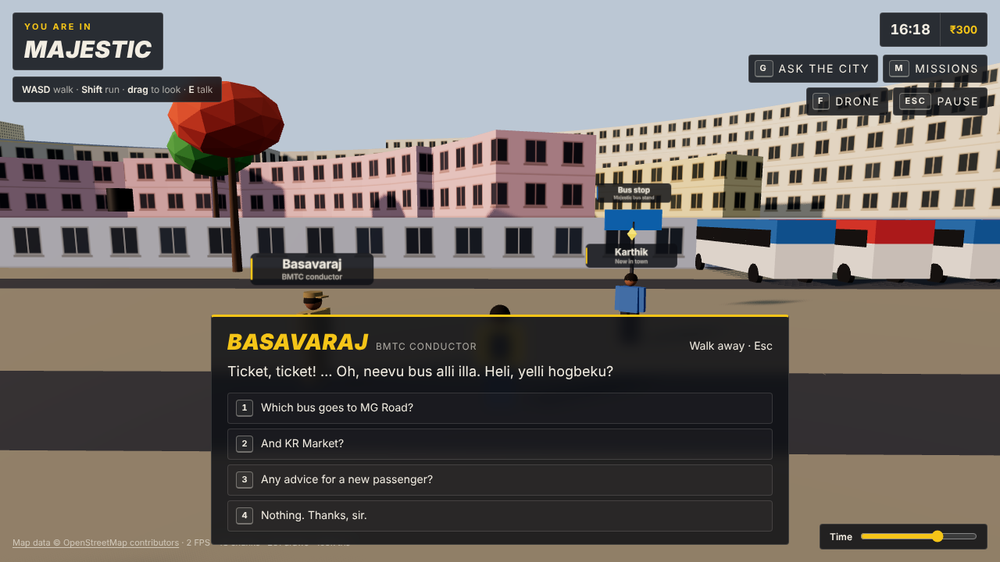
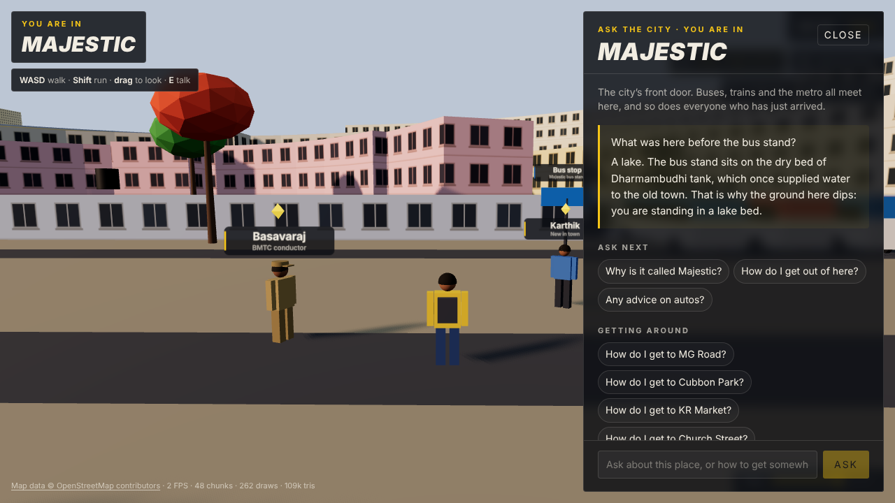
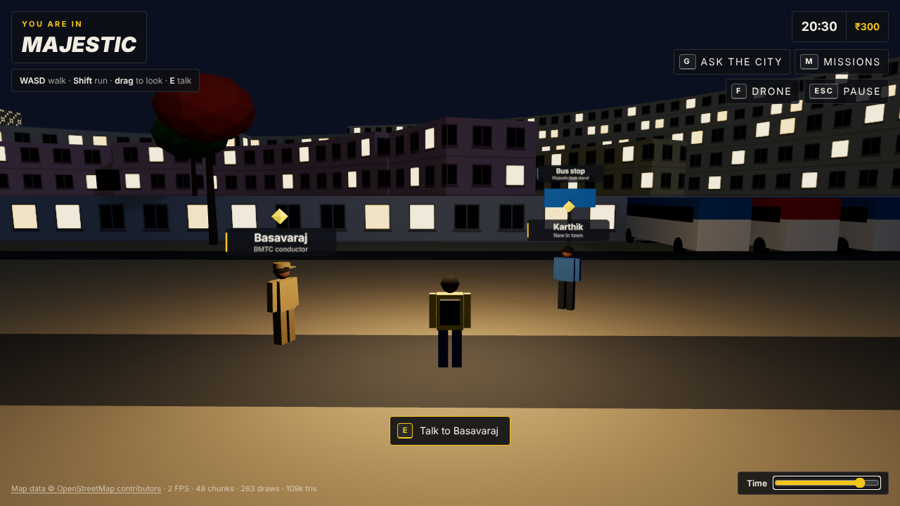

# Rowdy Journey (working title)

**Created & developed by Vikas T G** — Software Development Engineer, Bengaluru ·
[@18vikastg](https://github.com/18vikastg)

An original, open-world, browser-based 3D game set in the real streets of
Bengaluru, from Majestic to MG Road. Walk the city, borrow an auto, take the
metro, and talk to people who remember what you said to them.



| Ask the city                                  | Night                                |
| --------------------------------------------- | ------------------------------------ |
|  |  |

## What is in it

- **People who remember.** Nine characters with hand-written Kanglish
  dialogue. Manju the auto driver remembers how you haggle. Shanthakka at the
  darshini remembers your order. Give Karthik wrong directions at Majestic and
  he will have something to say when you meet him on Church Street.
- **Missions from real places.** Reach the office on MG Road before 9:00 by
  metro, bus, a haggled auto or a borrowed one. Carry a flask of coffee to
  Hudson Circle before it goes cold. Catch the seven o'clock bus in the rain.
  Peak-hour traffic and evening showers change what works.
- **Ask the city.** Press G anywhere for a guide to the area you are standing
  in: what the place is, its history, where to eat, how to get somewhere else.
- **The real map.** Streets, buildings and parks are baked from OpenStreetMap.

All dialogue is scripted; no AI service or API key is involved. Bus and metro
timings and fares are game values, not a real timetable.

## Controls

| Key         | Action                                |
| ----------- | ------------------------------------- |
| WASD, Shift | Walk, run; drive when in an auto      |
| Drag, wheel | Look around, zoom                     |
| E           | Talk, board, get in or out of an auto |
| 1 to 9      | Pick a reply                          |
| G / M       | Ask the city / missions and journal   |
| F           | Drone camera                          |
| Esc         | Back out, pause                       |

## Status

Pre-alpha. See the [roadmap](docs/ROADMAP.md).

## Quick start

```sh
corepack enable
pnpm install
pnpm dev
```

| Command                                    | What it does                                 |
| ------------------------------------------ | -------------------------------------------- |
| `pnpm dev` / `pnpm dev:site`               | Run the game / landing site locally          |
| `pnpm build`                               | Build everything                             |
| `pnpm lint`, `pnpm typecheck`, `pnpm test` | Static checks and unit tests                 |
| `pnpm e2e`                                 | Playwright smoke test against the built game |
| `pnpm world:fetch && pnpm world:bake`      | Rebuild the map from OpenStreetMap           |
| `pnpm world:sketch`                        | Bake a hand-drawn placeholder map, offline   |

## Layout

```
apps/game         Vite + React + three.js game
apps/site         Astro landing page
packages/engine   Game logic: dialogue, missions, traffic, transit, guide, map format
packages/content  Characters, missions, guide text, places, branding
tools/            Offline map and asset pipelines
docs/             Architecture, roadmap, contributing
```

More: [ARCHITECTURE](docs/ARCHITECTURE.md) · [CONTRIBUTING](docs/CONTRIBUTING.md) · [CREDITS](CREDITS.md)

## Credits

Created & developed by **Vikas T G**. Map data © OpenStreetMap contributors (ODbL). Third-party licences are listed in
[CREDITS.md](CREDITS.md). All models, writing and brands are original.
